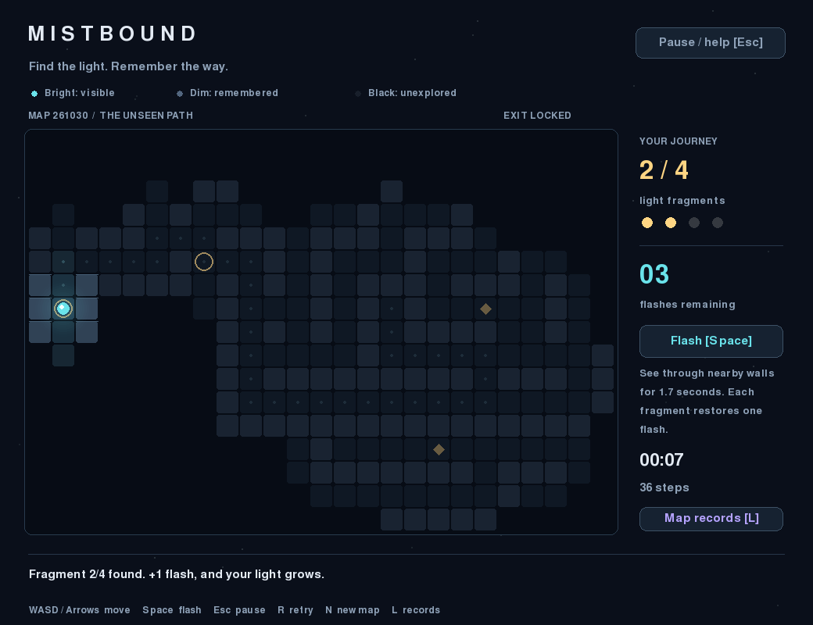
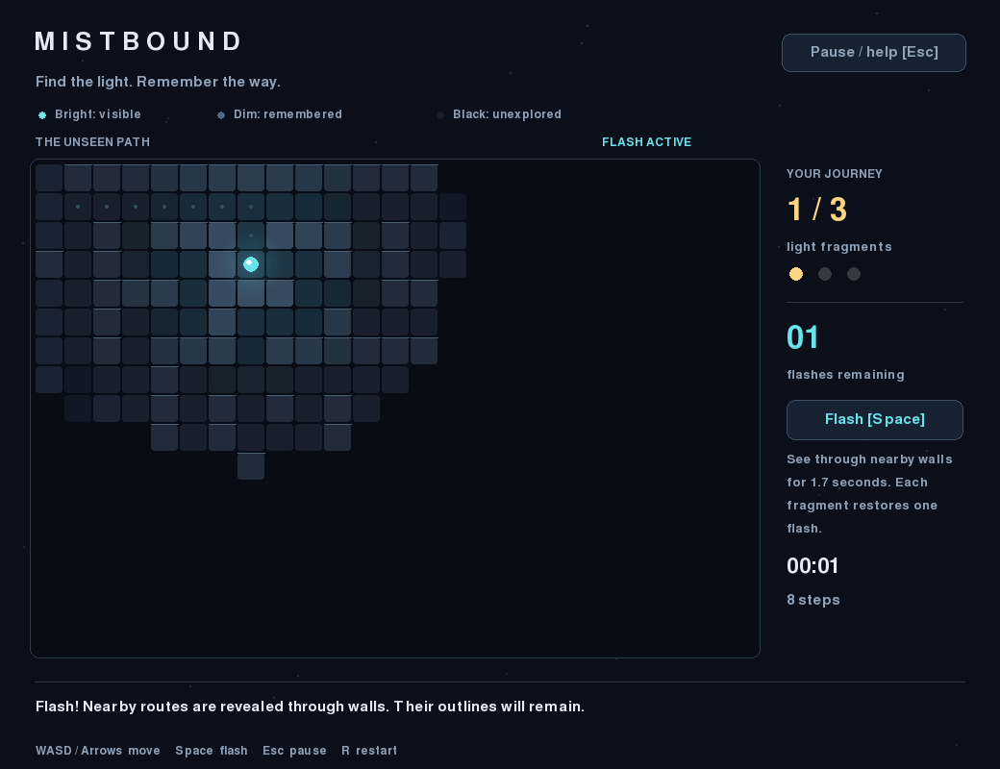
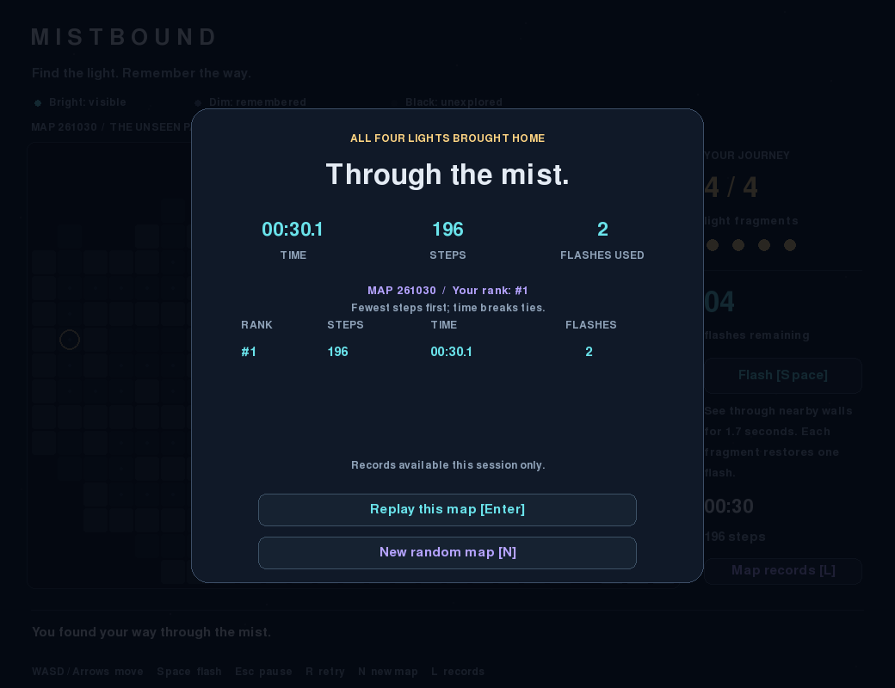

# Mistbound

**Find the light. Remember the way.** A small Python exploration game about navigating uncertainty with a limited resource.



## Idea and intended player

Mistbound is for someone who enjoys a short exploration puzzle. You are a small light in a fog-covered maze. Collect **four gold light fragments**, then reach the **green exit**. There are no enemies or time limits. The challenge is choosing where to explore and when to spend a flash.

Every new map randomizes the maze, starting point, fragment locations and exit. Reachable objectives are separated so they do not all appear beside the start. A six-digit map number lets you replay the same challenge and compare local records fairly.

## Interaction

- **Move:** WASD or arrow keys. Holding a direction moves at a controlled rate; walls block movement.
- **Flash:** Space or the Flash button. Start with **two charges**. A flash reveals nearby routes **through walls for 1.7 seconds**, and dim outlines remain afterward.
- **Sight:** normal vision starts at a radius of **2.5 tiles** and stops at walls. Each fragment adds **0.2 tiles**, reaching radius **3.3** after all four. Flash vision has a radius of **5 tiles** (up to 11 across). Both areas are circular. These values are midway between the original and reduced-sight versions.
- **Collect:** walk over a gold diamond. Each fragment restores one flash and slightly expands ordinary sight.
- **Exit:** enter the portal after collecting all four fragments. Before that, it explains how many are missing.
- **Pause/help:** Esc or the Pause button. Switching windows also pauses. Time and flash duration freeze while paused. Resume explicitly with Esc, Enter or Continue.
- **Retry this map:** R, then Enter to confirm. Layout and objectives stay identical; run progress resets. Esc cancels.
- **New random map:** N, then Enter to confirm during play. From the completion screen, N starts a new map immediately.
- **Map records:** L or the Map records button. This pauses the current run and shows the local top five for that map. Esc, Enter or L returns.
- **Stop:** close the window. The unfinished run is not saved.

**Bright** tiles are visible now; **dim** tiles were explored earlier; **black** areas are unknown. Small dots mark tiles you have stepped on. You can finish with zero flashes: ordinary sight never disappears.



## Local records

A completed run records **steps, active playing time and flashes used**. Ranking uses the fewest steps first, then the fastest time to a tenth of a second. Flashes are displayed but do not affect rank. Exact ties retain completion order. Only the best five runs for the **same map number and rules version** are kept; different maps are never ranked together.

Records are stored in `local_scores.json` beside the program. They survive closing the game. They contain no player names or account information, are local to this copy of the project, and are excluded from Git. This is a personal challenge board, not a verified online competition.

If the records file cannot be read or written, the game still works and explains that records are available only for this session. An unreadable file is left unchanged. Gameplay can continue with memory-only records.



## Run from a fresh terminal

Requirements: **uv**, Python **3.14**, an internet connection for initial installation, and a desktop display of at least **1040 × 800** plus the window frame. The game runs offline after installation.

Install uv from its official instructions if needed: <https://docs.astral.sh/uv/getting-started/installation/>.

Open a terminal in the downloaded/cloned project folder and run:

```sh
uv python install 3.14
uv sync --locked
uv run python main.py
```

To reopen a particular map, use its number:

```sh
uv run python main.py --seed 261030
```

Numbers from 0 to 999999 are supported. The same number reproduces the same map under the current version. On the development Mac, you can also double-click **Launch.command** after installing uv. In VS Code, open this folder and run the same commands in its terminal.

If a browser-based download loses the launcher's executable permission on macOS, run `chmod +x Launch.command` from the project folder, or use the primary `uv run python main.py` command above.

The dependency is **pygame-ce**, imported as `pygame`. Its exact version is recorded in `uv.lock`. Do not separately install the original `pygame` into this environment: both share an import name. No API keys, accounts, external assets or microphone are needed.

## Verification and example frames

```sh
uv run python -m unittest -v
```

All **21 tests** pass. They cover random-map connectivity and objective spacing, replay reproducibility, midpoint sight ranges and growth, fog memory, collection, completion without flashes, pause and confirmation handling, ranking and map isolation, persistence, and missing/corrupt/unwritable score files. Automated checks are developer verification, not a participant trial.

An additional stress check passed on 1,000 map numbers: all floor tiles were connected, objectives were reachable and minimum start spacing held. The environment is macOS, Python 3.14.7 and pygame-ce 2.5.8. The revised application also opened and rendered with the native Cocoa display driver. Windows and Linux have not been tested.

The README images are actual game-rendered frames from a scripted example. The preview uses memory-only records and does not read or change your real leaderboard. To regenerate them:

```sh
uv run python main.py --screenshots docs
```

On a headless macOS/Linux machine, prefix this image command with `SDL_VIDEODRIVER=dummy`. Normal play needs a desktop.

## Files

| File | Purpose |
| --- | --- |
| `main.py` | Window, input, rendering, menus and game loop |
| `game.py` | Movement, fog, collection, flashes and completion |
| `maze.py` | Seeded maze generation, spacing rules and path searches |
| `scores.py` | Local top-five ranking, loading and atomic saving |
| `test_game.py`, `test_scores.py` | Gameplay and record-file checks |
| `pyproject.toml`, `uv.lock`, `.python-version` | Reproducible environment |
| `PROCESS.md`, `CREDITS.md` | Design process, AI contribution and credits |
| `docs/CODE_GUIDE.md` | Guide to explaining the program |
| `docs/USER_TRIAL.md` | Actual roommate feedback and resulting decisions |
| `docs/SUBMISSION_CHECKLIST.md` | Remaining submission preparation |

## Limitations and submission status

Closing loses an unfinished run. Only completed records persist. The UI is English, uses a fixed window size and has no sound. It has not been evaluated for screen-reader use. Local records do not sync across computers. Map numbers are reproducible within this rules version; generation or gameplay changes should increment the map version.

The roommate tried the original game without a prior explanation. Their feedback informed random maps, an initial sight reduction, a fourth fragment and same-map records. After restoring the larger sight ranges, the student found them too large and requested a midpoint. The current rules use version v4, keeping earlier visibility versions' records separate. See PROCESS.md. The current version has not yet had a participant retest. The student must follow the run instructions and review the code.

Public repository: [Heming-G/MistBound](https://github.com/Heming-G/MistBound). On 31 October 2026, unauthenticated checks verified public access and all 22 source, documentation and image files against the local version. Development history is maintained in Git commits; the submission checklist tracks final publication verification.
